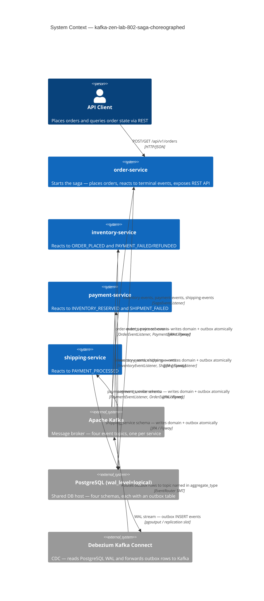
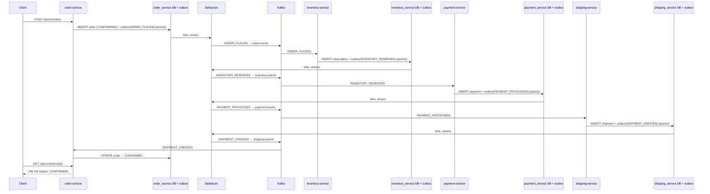
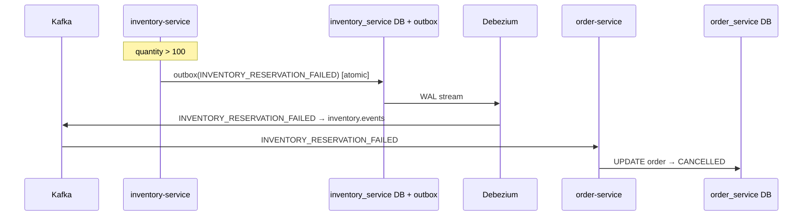
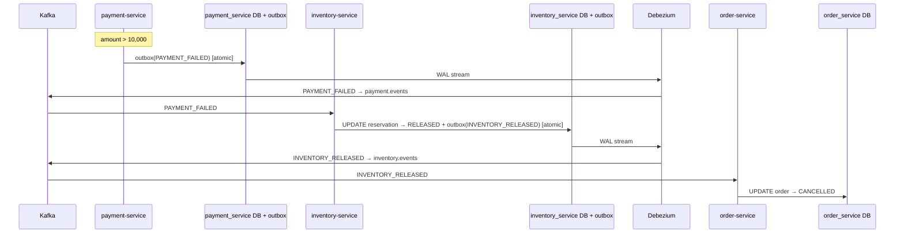
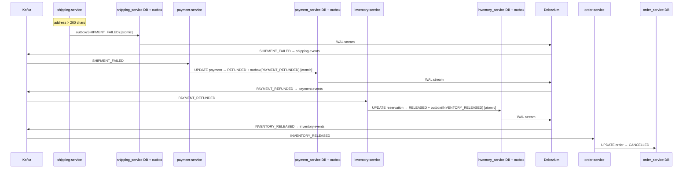
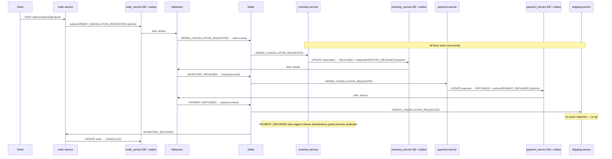
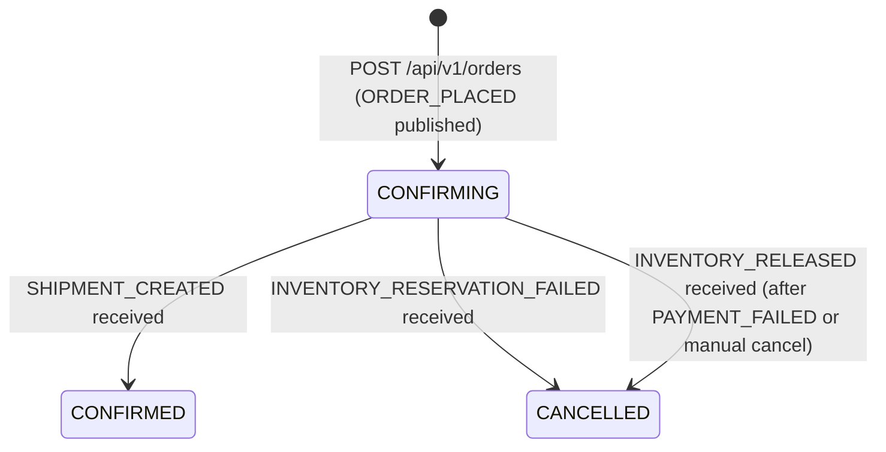

# Architecture

## Overview

`kafka-zen-lab-802-saga-choreographed` implements the **Saga Choreography** pattern across four independent Spring Boot
microservices. There is no central orchestrator. Each service publishes domain events to its own Kafka topic and
subscribes to the topics of other services it needs to react to.

1. **order-service** (`zen.labs.order`) — starts the saga by publishing `ORDER_PLACED`; reacts to terminal events
   to confirm or cancel the order; exposes the only public REST API.
2. **inventory-service** (`zen.labs.inventory`) — reacts to `ORDER_PLACED` by reserving inventory; reacts to
   `PAYMENT_FAILED` / `PAYMENT_REFUNDED` by releasing inventory.
3. **payment-service** (`zen.labs.payment`) — reacts to `INVENTORY_RESERVED` by processing payment; reacts to
   `SHIPMENT_FAILED` by refunding.
4. **shipping-service** (`zen.labs.shipping`) — reacts to `PAYMENT_PROCESSED` by creating a shipment.

All four services follow the same **Hexagonal (Ports and Adapters) Architecture** with four strictly separated layers.
ArchUnit tests enforce these boundaries at build time. Four shared Gradle library modules carry cross-cutting
infrastructure code (`common-adapter-components`, `common-application-components`, `common-domain-components`,
`common-infra-components`).

Events are delivered to Kafka via the **Transactional Outbox** pattern: each service writes an outbox row in the same
database transaction as its domain change. Debezium CDC reads the PostgreSQL WAL and forwards the rows to Kafka.
Direct Kafka writes from application code are eliminated, preventing the dual-write problem.

---

## System Context



---

## Transactional Outbox Pattern

Each service writes to an `outbox` table in the same transaction as its domain write. No Kafka producer is called
directly from application code.

```
Application code (in @Transactional)
  ├── INSERT domain record (order, reservation, payment, shipment)
  └── INSERT outbox row (aggregate_type, aggregate_id, type, payload)
        │
        │  (committed atomically)
        ▼
  PostgreSQL WAL (wal_level=logical)
        │
        ▼
  Debezium Postgres Connector
  (reads replication slot, publishes CDC events)
        │
        ▼
  EventRouter SMT — routes by aggregate_type column → Kafka topic name
        │
        ▼
  Kafka topic  (key = aggregate_id = orderId)
```

### Outbox table schema (identical in all four service schemas)

```sql
outbox (
    id             uuid         primary key default gen_random_uuid(),
    aggregate_type varchar(500) not null,   -- Kafka topic name (routes Debezium EventRouter)
    aggregate_id   varchar(255) not null,   -- orderId (Kafka partition key)
    type           varchar(255) not null,   -- SagaEventType name
    payload        text         not null,   -- full SagaEvent JSON
    created_at     timestamptz  not null default now()
)
```

Outbox rows accumulate (no deletion). Indexes on `aggregate_id` and `created_at` support future cleanup or replay.

### Debezium connector configuration (per service)

One `kafka-connect` container hosts four connectors (one per service schema). Each connector is registered at
startup by the `connector-registrar` container. Example — `order-outbox-connector`:

```json
{
  "connector.class": "io.debezium.connector.postgresql.PostgresConnector",
  "table.include.list": "order_service.outbox",
  "publication.autocreate.mode": "filtered",
  "transforms": "outbox",
  "transforms.outbox.type": "io.debezium.transforms.outbox.EventRouter",
  "transforms.outbox.route.by.field": "aggregate_type",
  "transforms.outbox.table.field.event.key": "aggregate_id",
  "transforms.outbox.table.field.event.payload": "payload"
}
```

The `aggregate_type` value written by each `*EventPublisherAdapter` equals the Kafka topic name (e.g.
`kafka-zen.lab-802.saga.order.events`), so Debezium routes each row to the correct topic without additional
configuration.

---

## Kafka Topic Model

Four topics, one per publishing service. All use `StringSerializer` / `StringDeserializer`. The `orderId` is used
as the Kafka message key (= `aggregate_id` column), guaranteeing per-order ordering within a partition.

| Topic | Publisher | Consumers |
|---|---|---|
| `kafka-zen.lab-802.saga.order.events` | order-service | inventory-service, payment-service, shipping-service |
| `kafka-zen.lab-802.saga.inventory.events` | inventory-service | order-service, payment-service |
| `kafka-zen.lab-802.saga.payment.events` | payment-service | inventory-service, shipping-service, order-service |
| `kafka-zen.lab-802.saga.shipping.events` | shipping-service | order-service, payment-service |

Topics are auto-created at startup by `TopicProvisioner` (local dev only). In production, provision via Terraform or
a Kubernetes operator.

### Dead Letter Queues

Failed messages are forwarded to `<topic>.dlq` after 3 retries with a 1-second `FixedBackOff`.
`IllegalArgumentException` and `NullPointerException` are non-retryable and sent to DLQ immediately.

---

## Choreography Event Flow

### Happy Path



### Compensation: Inventory Reservation Failure



### Compensation: Payment Failure



### Compensation: Shipment Failure



### Manual Cancellation (POST /api/v1/orders/{id}/cancel)



---

## Event Subscription Map

Each service subscribes only to the topics it needs. The table shows which events each service acts on.

| Event | Topic | order-service | inventory-service | payment-service | shipping-service |
|---|---|---|---|---|---|
| `ORDER_PLACED` | order.events | — | reserve inventory | — | — |
| `ORDER_CANCELLATION_REQUESTED` | order.events | — | release inventory | refund payment | cancel shipment |
| `INVENTORY_RESERVED` | inventory.events | — | — | process payment | — |
| `INVENTORY_RESERVATION_FAILED` | inventory.events | cancel order | — | — | — |
| `INVENTORY_RELEASED` | inventory.events | cancel order | — | — | — |
| `PAYMENT_PROCESSED` | payment.events | — | — | — | create shipment |
| `PAYMENT_FAILED` | payment.events | — | release inventory | — | — |
| `PAYMENT_REFUNDED` | payment.events | — | release inventory | — | — |
| `SHIPMENT_CREATED` | shipping.events | confirm order | — | — | — |
| `SHIPMENT_FAILED` | shipping.events | — | — | refund payment | — |

---

## Order Status Lifecycle

order-service has no SagaState. Order status reflects the saga outcome directly.



| Status | Meaning |
|---|---|
| `CONFIRMING` | Order placed; saga in progress |
| `CONFIRMED` | Saga completed — inventory reserved, payment processed, shipment created |
| `CANCELLED` | Saga failed or manually cancelled after compensation complete |

---

## Hexagonal Architecture Layer Model

All four microservices follow an identical four-layer model. Dependencies flow inward only. ArchUnit enforces this
on every build.

```
┌─────────────────────────────────────────────────────────────────────┐
│  infrastructure  (@Configuration, utils)                             │
│         ↓ (depends on domain + application only)                     │
├─────────────────────────────────────────────────────────────────────┤
│  adapter  (REST controllers, @KafkaListener, JPA repos, outbox)      │
│         ↓ (depends on domain + application only)                     │
├─────────────────────────────────────────────────────────────────────┤
│  application  (use-case ports + service impls)                       │
│         ↓ (depends on domain only)                                   │
├─────────────────────────────────────────────────────────────────────┤
│  domain  (pure model — zero Spring or framework imports)             │
└─────────────────────────────────────────────────────────────────────┘
```

The `*EventPublisherAdapter` classes live in `adapter/outbound/persistence/` because they write to the database
(the outbox table), not to Kafka directly. `TopicProvisioner` lives in `infrastructure/config/` because it is an
infrastructure lifecycle concern, not an adapter.

---

## Package Structure

### order-service (`zen.labs.order`)

```
zen.labs.order
├── domain
│   ├── Order                        Domain model — CONFIRMING / CONFIRMED / CANCELLED lifecycle
│   ├── OrderItem                    Value object (record) — productId, quantity, unitPrice
│   └── OrderStatus                  Enum: CONFIRMING, CONFIRMED, CANCELLED
│
├── application
│   ├── port/inbound/
│   │   ├── PlaceOrderUseCase        Start a new saga (publish ORDER_PLACED)
│   │   ├── PlaceOrderCommand        Command record (idempotencyKey, customerId, items, shippingAddress)
│   │   ├── HandleSagaEventUseCase   onInventoryReservationFailed / onInventoryReleased / onShipmentCreated
│   │   ├── CancelOrderUseCase       Publish ORDER_CANCELLATION_REQUESTED
│   │   ├── FindOrderUseCase         Fetch a single order
│   │   └── ListOrdersUseCase        List orders by customerId
│   ├── port/outbound/
│   │   ├── OrderDataStore           findByResourceId / save / update
│   │   ├── OrderEventPublisher      publishOrderPlaced / publishCancellationRequested
│   │   └── IdempotencyKeyStore      findOrderId / save
│   └── service/
│       ├── PlaceOrderService        Implements PlaceOrderUseCase
│       ├── CancelOrderService       Implements CancelOrderUseCase
│       ├── SagaEventHandler         Implements HandleSagaEventUseCase
│       └── OrderQueryService        Implements FindOrderUseCase, ListOrdersUseCase
│
├── adapter
│   ├── inbound/messaging/
│   │   └── SagaEventListener        @KafkaListener on inventory-, payment-, shipping-events → HandleSagaEventUseCase
│   ├── inbound/web/order/
│   │   ├── OrderController          POST /api/v1/orders, GET /api/v1/orders/{id}, POST …/cancel, GET /api/v1/orders
│   │   ├── CreateOrderRequest       Request record
│   │   └── OrderResponse            Response record with static from(Order) factory
│   ├── inbound/web/home/
│   │   └── RootController           GET / → HTTP 200
│   └── outbound/persistence/
│       ├── OrderEventPublisherAdapter  Implements OrderEventPublisher — writes to outbox table
│       ├── OrderJpaDataStore           Implements OrderDataStore
│       ├── IdempotencyKeyJpaDataStore  Implements IdempotencyKeyStore
│       ├── entity/                  OrderJpaEntity, OrderItemJpaEntity, OutboxJpaEntity, IdempotencyKeyJpaEntity
│       └── repository/              OrderRepository, OutboxRepository, IdempotencyKeyRepository
│
└── infrastructure/config/
    ├── KafkaConsumerConfiguration   ConcurrentKafkaListenerContainerFactory with DLQ recoverer
    ├── TopicProvisioner             Creates topics on ApplicationReadyEvent (local dev only)
    └── WebMvcConfiguration
```

### inventory-service (`zen.labs.inventory`)

```
zen.labs.inventory
├── domain
│   ├── InventoryReservation         sagaId, orderId, status, reservedAt
│   └── ReservationStatus            Enum: RESERVED, RELEASED
│
├── application
│   ├── port/inbound/
│   │   ├── HandleInventoryEventUseCase  handleOrderPlaced / handleRelease
│   │   └── OrderedItem              Value record — productId, quantity
│   ├── port/outbound/
│   │   ├── InventoryReservationDataStore
│   │   └── InventoryEventPublisher  publishInventoryReserved / publishInventoryReservationFailed / publishInventoryReleased
│   └── service/
│       └── InventoryEventService    Implements HandleInventoryEventUseCase
│           — failure rule: quantity > 100 per item → INVENTORY_RESERVATION_FAILED
│
├── adapter
│   ├── inbound/messaging/
│   │   ├── OrderEventListener       Listens order.events: ORDER_PLACED → reserve, ORDER_CANCELLATION_REQUESTED → release
│   │   └── PaymentEventListener     Listens payment.events: PAYMENT_FAILED / PAYMENT_REFUNDED → release inventory
│   ├── inbound/web/home/
│   │   └── RootController
│   └── outbound/persistence/
│       ├── InventoryEventPublisherAdapter  Writes INVENTORY_* events to outbox
│       ├── InventoryReservationJpaDataStore
│       ├── entity/                  InventoryReservationJpaEntity, OutboxJpaEntity
│       └── repository/              InventoryReservationRepository, OutboxRepository
│
└── infrastructure/config/
    ├── KafkaConsumerConfiguration
    └── TopicProvisioner
```

### payment-service (`zen.labs.payment`)

```
zen.labs.payment
├── domain
│   ├── Payment                      orderId, amount, status, processedAt
│   └── PaymentStatus                Enum: PROCESSED, REFUNDED
│
├── application
│   ├── port/inbound/
│   │   └── HandlePaymentEventUseCase  handleInventoryReserved / handleShipmentFailed / handleOrderCancellationRequested
│   ├── port/outbound/
│   │   ├── PaymentDataStore
│   │   └── PaymentEventPublisher    publishPaymentProcessed / publishPaymentFailed / publishPaymentRefunded
│   └── service/
│       └── PaymentEventService      Implements HandlePaymentEventUseCase
│           — failure rule: amount > 10,000 → PAYMENT_FAILED
│
├── adapter
│   ├── inbound/messaging/
│   │   ├── InventoryEventListener   Listens inventory.events: INVENTORY_RESERVED → process payment
│   │   ├── ShippingEventListener    Listens shipping.events: SHIPMENT_FAILED → refund payment
│   │   └── OrderEventListener       Listens order.events: ORDER_CANCELLATION_REQUESTED → refund if exists
│   └── outbound/persistence/
│       ├── PaymentEventPublisherAdapter
│       ├── PaymentJpaDataStore
│       ├── entity/                  PaymentJpaEntity, OutboxJpaEntity
│       └── repository/              PaymentRepository, OutboxRepository
│
└── infrastructure/config/
    ├── KafkaConsumerConfiguration
    └── TopicProvisioner
```

### shipping-service (`zen.labs.shipping`)

```
zen.labs.shipping
├── domain
│   └── Shipment / ShipmentStatus
│
├── application
│   ├── port/inbound/
│   │   └── HandleShipmentEventUseCase  handlePaymentProcessed / handleOrderCancellationRequested
│   ├── port/outbound/
│   │   ├── ShipmentDataStore
│   │   └── ShippingEventPublisher   publishShipmentCreated / publishShipmentFailed
│   └── service/
│       └── ShipmentEventService     Implements HandleShipmentEventUseCase
│           — failure rule: shippingAddress > 200 characters → SHIPMENT_FAILED
│
├── adapter
│   ├── inbound/messaging/
│   │   ├── PaymentEventListener     Listens payment.events: PAYMENT_PROCESSED → create shipment
│   │   └── OrderEventListener       Listens order.events: ORDER_CANCELLATION_REQUESTED → handle
│   └── outbound/persistence/
│       ├── ShippingEventPublisherAdapter
│       ├── ShipmentJpaDataStore
│       ├── entity/                  ShipmentJpaEntity, OutboxJpaEntity
│       └── repository/              ShipmentRepository, OutboxRepository
│
└── infrastructure/config/
    ├── KafkaConsumerConfiguration
    └── TopicProvisioner
```

### Common Library Modules

| Module | Key Classes |
|---|---|
| `common-adapter-components` | `SagaEvent` sealed interface hierarchy, `SagaEventType` enum, `SagaEventItem` record, `GlobalExceptionHandler`, `CorrelationIdFilter`, `LoggingFilter`, `@Alphabetic`, `@ResourceId`, `@SearchText` validators |
| `common-application-components` | `ApplicationException`, `BadRequestException`, `ResourceNotFoundException`, `UnprocessableRequestException`, `ResourceIdSupplier` port |
| `common-domain-components` | `ResourceIdAware` marker interface, `ResourceIdFormat` regex constant |
| `common-infra-components` | `JacksonConfiguration`, `DateTimeFormatConfiguration`, `LocalDateConverter`, `ResourceIdSupplierConfiguration` (Spring auto-configuration), `ResourceIdGenerator`, `SpringProfiles`, `SagaTopicsProperties` |

---

## Gradle Multi-Module Structure

```
kafka-zen-lab-802-saga-choreographed/       Root project
├── build.gradle                             JaCoCo aggregation, Sonar, Nebula lint
├── settings.gradle                          Declares all subprojects
├── gradle.properties                        JVM property overrides
├── .java-version                            Java toolchain version pin
├── gradle/
│   ├── libs.versions.toml                   Version catalog
│   ├── wrapper/                             Gradle wrapper
│   └── plugins/java-conventions/            Convention plugins (buildlogic.*)
├── common-adapter-components/               Shared adapter library
├── common-application-components/           Shared application library
├── common-domain-components/                Shared domain library
├── common-infra-components/                 Shared infrastructure library (auto-configured)
├── docker/
│   ├── docker-compose.yml                   All infrastructure + services
│   └── connectors/                          Debezium connector JSON configs (4 files)
├── order-service/
│   └── src/
│       ├── main/java/zen/labs/order/
│       ├── main/resources/                  application.yml, db/migration/ (V0001–V0007)
│       ├── test/                            Unit tests + OrderServiceArchitectureTest
│       └── integrationTest/                 Integration tests (Testcontainers)
├── inventory-service/
├── payment-service/
└── shipping-service/
```

---

## Database Schema

All four services share a single PostgreSQL instance (`localhost:5432/postgres`, `wal_level=logical`) with isolated
schemas managed independently by Flyway.

### order_service schema

```sql
orders (id BIGSERIAL PK, resource_id VARCHAR UNIQUE, customer_id VARCHAR,
        status VARCHAR, shipping_address TEXT, created_at TIMESTAMPTZ)
order_item (id BIGSERIAL PK, order_id BIGINT FK→orders, product_id VARCHAR,
            quantity INT, unit_price NUMERIC(19,4))
idempotency_key (id BIGSERIAL PK, key VARCHAR UNIQUE, order_id VARCHAR, created_at TIMESTAMPTZ)
outbox (id UUID PK, aggregate_type VARCHAR(500), aggregate_id VARCHAR(255),
        type VARCHAR(255), payload TEXT, created_at TIMESTAMPTZ)
```

Note: `order-service` has no `saga_state` table. Order status reflects the saga outcome directly.

### inventory_service schema

```sql
inventory_reservation (id BIGSERIAL PK, order_id VARCHAR UNIQUE,
                        status VARCHAR, reserved_at TIMESTAMPTZ)
outbox (id UUID PK, aggregate_type VARCHAR(500), aggregate_id VARCHAR(255),
        type VARCHAR(255), payload TEXT, created_at TIMESTAMPTZ)
```

### payment_service schema

```sql
payment (id BIGSERIAL PK, order_id VARCHAR UNIQUE,
         amount NUMERIC(19,4), status VARCHAR, processed_at TIMESTAMPTZ)
outbox (id UUID PK, ...)
```

### shipping_service schema

```sql
shipment (id BIGSERIAL PK, order_id VARCHAR UNIQUE,
          shipping_address TEXT, status VARCHAR, created_at TIMESTAMPTZ)
outbox (id UUID PK, ...)
```

---

## ArchUnit — Architecture as Tests

Each service has an `*ArchitectureTest.java` unit test that runs on every build.

### Layer dependency rules

| Rule | Description |
|---|---|
| `domain_must_not_depend_on_other_layers` | `domain..` has no imports from application, adapter, or infrastructure |
| `application_must_not_depend_on_outer_layers` | `application..` has no imports from adapter or infrastructure |
| `adapters_must_not_depend_on_infrastructure` | `adapter..` has no imports from infrastructure |
| `infrastructure_must_not_depend_on_adapters` | `infrastructure..` has no imports from adapter |

### Domain purity

| Rule | Description |
|---|---|
| `domain_must_not_depend_on_springframework` | `domain..` has zero `org.springframework..` imports |

### Naming conventions

| Rule | Assertion |
|---|---|
| `rest_controllers_must_be_suffixed_controller` | All `@RestController` classes end with `Controller` |
| `rest_controllers_must_reside_in_adapter_inbound` | All `@RestController` classes live in `adapter.inbound..` |
| `controller_advice_must_reside_in_infrastructure_advice` | All `@ControllerAdvice` classes live in `zen.labs.adapters.common.handlers..` |
| `configuration_classes_must_be_suffixed_configuration` | All `@Configuration` classes in `infrastructure.config..` end with `Configuration` |

### Spring best practices

| Rule | Assertion |
|---|---|
| `no_field_injection` | No fields annotated with `@Autowired` — constructor injection only |

---

## Distributed Tracing

All four services export OpenTelemetry traces via OTLP HTTP to Jaeger. Traces span service boundaries via
W3C `traceparent` headers propagated automatically in Kafka messages.

### Dependencies

Each service includes:
- `io.micrometer:micrometer-tracing-bridge-otel` — Micrometer → OTel bridge
- `io.opentelemetry:opentelemetry-exporter-otlp` — OTLP exporter (runtime only)

### Configuration (`application.yml`)

```yaml
spring:
  kafka:
    listener:
      observation-enabled: true   # instruments @KafkaListener with Micrometer Observation
    template:
      observation-enabled: true   # instruments KafkaTemplate sends

management:
  tracing:
    sampling:
      probability: 1.0            # 100% sampling — reduce in production
  otlp:
    tracing:
      endpoint: ${OTEL_EXPORTER_OTLP_ENDPOINT:http://localhost:4318/v1/traces}
```

### Docker Compose

Jaeger (`jaegertracing/jaeger:2.21.0`) is included in all three compose variants. Each service container
receives `OTEL_EXPORTER_OTLP_ENDPOINT: http://jaeger:4318/v1/traces`. IDE-run services use the
`localhost:4318` default from `application.yml`.

| UI | URL |
|---|---|
| Jaeger trace explorer | `http://localhost:16686` |

### What a Saga Trace Looks Like

One HTTP request to `POST /api/v1/orders` produces a single trace containing spans across all four services,
linked by the same trace ID propagated through Kafka headers:

```
[order-service: POST /orders]
  └─ [order-service: produce → order.events]
       └─ [inventory-service: consume ← order.events]
            └─ [inventory-service: produce → inventory.events]
                 └─ [payment-service: consume ← inventory.events]
                      └─ [payment-service: produce → payment.events]
                           └─ [shipping-service: consume ← payment.events]
                                └─ [shipping-service: produce → shipping.events]
```

---

## MDC Logging

All Kafka listeners inject structured fields into the SLF4J MDC on the listener thread, cleared in a `finally`
block after each record.

| Service | Listener | MDC fields |
|---|---|---|
| order-service | `SagaEventListener` | `orderId`, `eventType` |
| inventory-service | `OrderEventListener` | `orderId` |
| inventory-service | `PaymentEventListener` | `orderId` |
| payment-service | `InventoryEventListener` | `orderId` |
| payment-service | `ShippingEventListener` | `orderId` |
| shipping-service | `PaymentEventListener` | `orderId` |
| shipping-service | `OrderEventListener` | `orderId` |

---

## Design Decisions

| Decision | Rationale |
|---|---|
| **Choreography over orchestration** | No central saga state machine. Each service reacts to what it cares about. Coupling is implicit (events), making individual services simpler and independently deployable. The tradeoff is that the full saga flow is distributed across listener classes rather than visible in one place. |
| **Transactional Outbox + Debezium** | Writing the outbox row in the same transaction as the domain change eliminates the dual-write problem. Debezium reads the PostgreSQL WAL — no polling, no missed events, exactly-once delivery semantics from the write side. |
| **Topic per service** | Each service publishes to its own topic. Consumers subscribe only to the topics they need. This is more explicit than a single shared topic and avoids content-based routing in consumers. |
| **`aggregate_type` = Kafka topic name** | The EventRouter SMT routes each outbox row to the topic named in `aggregate_type`. Setting this field to the Kafka topic name directly means no additional Debezium transform configuration is required — the routing is self-describing. |
| **`aggregate_id` = `orderId`** | Using `orderId` as the Kafka partition key guarantees that all events for a given order arrive in the order they were written, regardless of which service published them. |
| **No SagaState in order-service** | The 801 orchestrated project used a `SagaState` entity to track saga progress. In choreography, the order status itself reflects the outcome. Removing `SagaState` simplifies the order-service domain model. |
| **Outbox rows accumulate (no deletion)** | In a lab context, simplicity outweighs storage cost. In production, add a scheduled cleanup job or set `transforms.outbox.delete.tombstone.handling.mode` in the Debezium connector. |
| **Simulated participant failures** | Each service enforces a simple business rule for deterministic failures: inventory — quantity > 100; payment — amount > 10,000; shipment — address > 200 characters. This enables testing compensation flows without external systems. |
| **Constructor injection only** | `@Autowired` field injection is banned by ArchUnit. Constructor injection makes dependencies explicit and simplifies testing without a Spring context. |
| **`SagaTopicsProperties` in `common-infra-components`** | A single shared `@ConfigurationProperties` record eliminates four per-service copies. All services already depend on `common-infra-components`, and it has `spring-boot-autoconfigure` on its classpath. |
| **Debezium `publication.autocreate.mode: filtered`** | Each connector's PostgreSQL publication covers only the table listed in `table.include.list` (e.g. `order_service.outbox`). `all_tables` would replicate WAL for every table in the shared database, wasting replication bandwidth and leaking schema information across service boundaries. |
| **`PAYMENT_REFUNDED` published on manual cancellation** | When `ORDER_CANCELLATION_REQUESTED` arrives, `payment-service` refunds and publishes `PAYMENT_REFUNDED`. This ensures the event appears in the audit trail and allows any future consumer of the payment topic to observe the refund, regardless of how it was triggered. |
